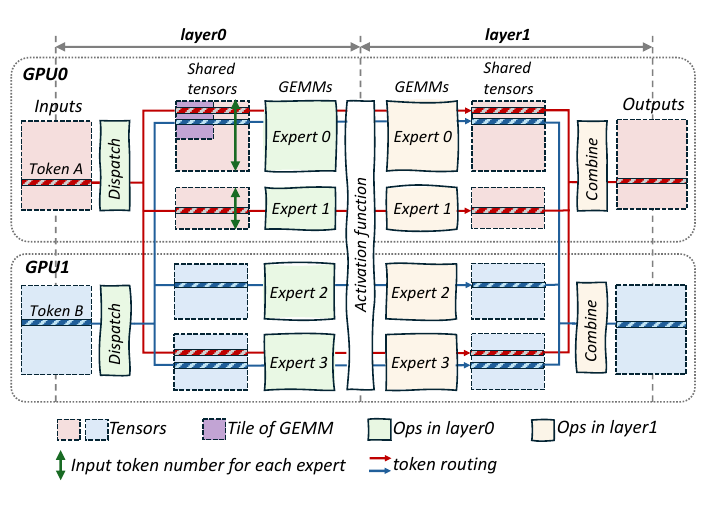
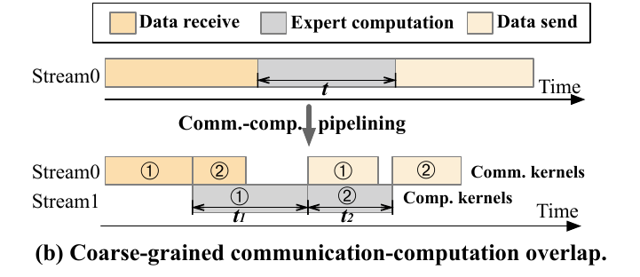
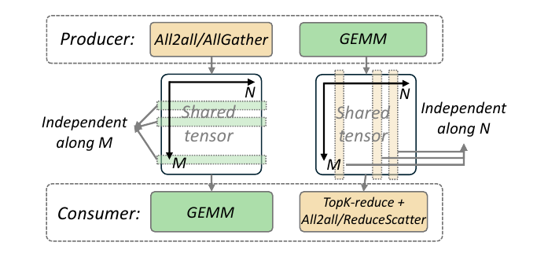
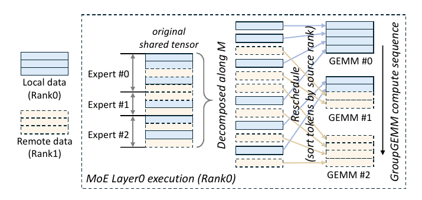
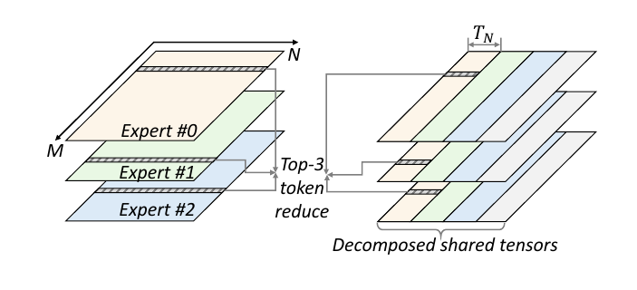
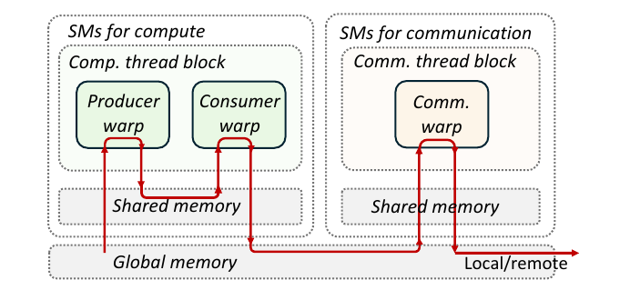
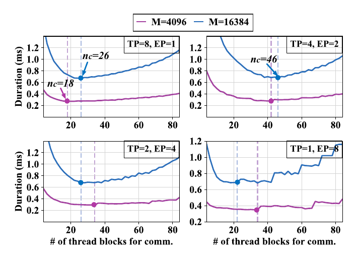

# Comet: pushing MoE compute–communication overlap from chunks to tiles

**Question:** Splitting an MoE layer's input into a few chunks and pipelining them already hides some communication. Why is that not enough, and how can overlap be made much finer without making the expert GEMMs slower?

- Paper: Shulai Zhang, Ningxin Zheng, et al., *Comet: Fine-grained Computation-communication Overlapping for Mixture-of-Experts*, MLSys '25 ([arXiv 2502.19811](https://arxiv.org/abs/2502.19811), [code: bytedance/flux](https://github.com/bytedance/flux))
- Setting: forward pass of an MoE layer under expert parallelism (EP), tensor parallelism (TP), or a mix; experiments on one 8×H800 NVLink node
- Core idea: the buffer that communication and computation both touch (the **shared tensor**) is split along the **consumer's independent dimension**, then the computation is reordered at **GEMM-tile granularity, earliest-needed first**. Inside one fused kernel, **dedicated thread blocks** do computation and communication separately, and the split between them is tuned offline per configuration.

Related: [Syncopate](2026-osdi-syncopate.md) attacks the same problem with a compiler and a tunable chunk. It cites Flux as the per-tile end of the design space, and Comet comes from the Flux team.

---

## 0. Five facts everything else follows from

Each design choice in the paper is a direct consequence of the facts below, so it pays to get them straight first.

### 0.1 What an MoE layer computes

Symbols follow the paper:

| Symbol | Meaning |
|---|---|
| M | number of tokens (sequence length × batch) |
| N | token embedding size (model hidden size) |
| K | hidden size of each expert's FFN |
| E | number of experts |
| topk | experts each token is routed to |
| TP / EP | tensor / expert parallel size; world size W = TP × EP |

For each token:

1. The gate picks its topk experts.
2. Each chosen expert runs a two-layer FFN: layer0 weights are `N × K`, layer1 weights are `K × N`.
3. The topk outputs are weighted and summed into one result.

So every token is **copied topk times**, processed by different experts, and **merged back into one**. The copying and merging are where communication comes from.

### 0.2 Why expert parallelism creates communication

Experts do not fit on one GPU, so they are spread across GPUs (EP), while tokens are spread by data parallelism. Each MoE layer therefore moves data twice:

- **dispatch** (before layer0): send each token to the GPUs holding its topk experts
- **combine** (after layer1): send expert outputs back to the token's home GPU and reduce over topk

The paper measures that cross-GPU communication averages 47% of forward time for several popular MoE models on 8×H800 with Megatron-LM (its Fig. 1a).

This gives two pipelines running in opposite directions:

```text
layer0:  communication (dispatch) ─produces─▶ [buffer] ─consumed by─▶ computation (GroupGEMM)
layer1:  computation (GroupGEMM)  ─produces─▶ [buffer] ─consumed by─▶ top-k reduce + communication (combine)
```



*Figure: paper Fig. 2.*

### 0.3 Why a GEMM must work in whole tiles

A GEMM `C = A · B` is split into output tiles (for example 128×128), one per thread block. The block that owns a `TM × TN` tile streams a `TM`-row band of A and a `TN`-column band of B along the reduction dimension of length `R`. With BF16 (2 bytes):

- bytes loaded: `2 · (TM + TN) · R`
- FLOPs: `2 · TM · TN · R` (a multiply-add counts as 2)
- arithmetic intensity: `TM · TN / (TM + TN)` FLOP/byte

With `TM = TN = 128` that is 64; with `TM = 16, TN = 128` it is about 14, so each byte moved buys over 4× less math.

There is also a hard floor: Tensor Core instructions have minimum shapes. A Hopper `wgmma` has M fixed at 64. A tile holding only 8 real tokens still pays for 64 rows, wasting 7/8 of the Tensor Core work.

**Conclusion: an efficient GEMM needs a full block of rows at once.** This is why the shared tensor, once split, has to be regrouped into tiles (§6).

### 0.4 How much overlap can save

Run serially, two tasks take `T_comm + T_comp`; perfectly overlapped, `max(T_comm, T_comp)`. Reaching that bound needs:

1. **Dependencies:** the consumer can start when the producer has finished only part of its work.
2. **Resources:** running both at once does not slow either one down.

Comet's dependency resolving handles (1); its adaptive workload assignment handles (2).

### 0.5 Reduction dimensions and independent dimensions

Everything in §5 rests on this pair of terms:

- A dimension an operation **sums over** is a **reduction dimension**: producing any output needs all data along it.
- A dimension whose positions **never enter each other's computation** is an **independent dimension**: one slice of input yields the matching slice of output.

**Only a split along an independent dimension lets the consumer process slices as they arrive.** Split along a reduction dimension and the consumer still waits for everything.

---

## 1. Coarse-grained overlap and what it costs

Prior systems (FasterMoE, Tutel, PipeMoE, and others) split the received input into a few chunks so chunk 2 transfers while chunk 1 computes.



*Figure: paper Fig. 1(b).*

This leaves three costs:

1. **Smaller chunks mean thinner GEMMs.** By §0.3, efficiency drops, so the two halves take longer than the whole: `t1 + t2 > t`.
2. **The ends cannot be hidden.** Receiving the first chunk and sending the last have nothing to overlap with, and coarser chunks make these phases longer.
3. **Separate kernels on separate streams leave resources uncontrolled.** How many SMs each kernel gets is up to the hardware scheduler, durations vary from run to run, and the two pipelines drift out of alignment. Per-chunk, per-expert launches also add host-side scheduling cost, which dominates when M is small.

> **My understanding**
>
> My first note said coarse-grained methods "split the input into chunks", which is right, but I only saw the granularity problem. I missed costs 1 and 3: **coarse overlap not only hides too little, it also makes the computation itself slower and the two pipelines hard to line up.** So Comet cannot simply cut finer, because finer cuts make cost 1 worse. That tension is the heart of the paper.

---

## 2. Why fine-grained overlap is hard

Going down to token or tile granularity runs into three obstacles.

**Obstacle 1: the units do not match.** Communication naturally moves tokens (rows); computation consumes tiles (say 128 rows). The 128 tokens a tile needs are picked by the gate at run time and may live on several GPUs. In Fig. 2, Expert0's tile cannot start until both token A and token B have arrived.

**Obstacle 2: remote I/O stalls the compute pipeline.** Remote accesses have far higher latency than local HBM. On Hopper, a GEMM is a tight asynchronous pipeline of TMA loads feeding Tensor Core MMAs; one long-latency remote access inside a compute block stalls it.

**Obstacle 3: load is dynamic.** Routing changes every iteration, so each expert receives a different number of tokens; clusters also differ in compute and bandwidth. Which side is heavier is only known at run time.

Comet answers obstacle 1 with **dependency resolving** and obstacles 2 and 3 with **thread block specialization plus adaptive assignment**.

---

## 3. Two levels of producer–consumer

> **My understanding**
>
> My first notes said "Producer: TMA, GMEM → SMEM; Consumer: Tensor Core", and separately "P→D split on M, D→P split on N". I had merged two different producer–consumer relationships into one. There are two levels:

**Outer level (the paper's subject, pipeline level):**

| | layer0 | layer1 |
|---|---|---|
| producer | communication: dispatch, receive tokens | computation: GroupGEMM |
| consumer | computation: GroupGEMM | top-k reduce + communication: combine |
| direction | communication → computation | computation → communication |

My "P→D" and "D→P" were these two: comm→compute and compute→comm.

**Inner level (inside the GEMM, warp level):** CUTLASS GEMMs on Hopper already use warp specialization. A producer warp uses TMA to load from HBM into SMEM; consumer warps run Tensor Core MMAs. **Comet leaves this untouched**; the paper stresses that its compute blocks reuse the unfused GEMM implementation.

So "communication–computation overlap" and "data-movement–computation overlap" are **the same thing in this paper**: the outer level. The inner TMA/MMA pipeline is background, and it is exactly what obstacle 2 threatens.

---

## 4. What the shared tensor is

> **My understanding**
>
> I could not tell whether the shared tensor was a hardware or a software concept. It is **a software concept and has nothing to do with SMEM (shared memory)**; the name is misleading.

The shared tensor is the buffer the outer producer writes and the outer consumer reads:

- It lives in **global memory (HBM)**, not on chip.
- Its logical shape is `(M × topk, N)` in both layers: one row per token copy.
  - layer0: tokens received by communication and grouped by expert, which is also the GroupGEMM input.
  - layer1: the GroupGEMM output, which is also the input to the top-k reduction.
- It is allocated with **NVSHMEM**, which gives multiple GPUs one global address space and lets a kernel issue fine-grained remote reads and writes directly, instead of calling a whole collective as with NCCL. That is what makes "each tile fetches just the tokens it needs" possible.
- Cost: one `M × N` buffer, `2MN` bytes in BF16, shared by all layers. The paper reports 64 MB for Mixtral 8x7B at M = 8192.



*Figure: paper Fig. 4.*

"Dependency resolving" means **analyzing how the producer and the consumer each access this buffer**, to find the direction in which the consumer can start with only part of it.

---

## 5. How to split: work backwards from the consumer's reduction dimension

### 5.1 The rule

From §0.5: **split along the consumer's independent dimension, never its reduction dimension.** The consumer decides the split, not the producer.

### 5.2 layer0: the consumer is a GEMM → split along M (tokens)

The consumer is `Y = X · W₀`, with X the shared tensor `(tokens, N)` and W₀ of shape `(N, K)`.

- Output row i depends only on row i of X. Tokens do not interact, so **M is independent → split it**.
- Each output element is `Σₙ X[i, n] · W₀[n, k]`, a reduction over N, so **N is a reduction dimension → do not split it**.

Small example: a tile owns tokens 0–127. Once those 128 full rows have arrived, it can finish without waiting for token 128 onward. If it had only the first half of N for those rows, it could compute only partial sums and nothing would be final.

### 5.3 layer1: the consumer is a top-k reduction → split along N (hidden)

The layer1 GroupGEMM output is the shared tensor `(M × topk, N)`. Each token has topk rows, scattered across different experts' output regions. The consumer computes:

```text
out[A] = Y[A's row from E0] + Y[A's row from E1] + Y[A's row from E3]
```

- **Along M:** token A needs rows from several experts. If the GroupGEMM runs expert by expert, A is still missing E1's and E3's rows when E0 finishes. Rows depend on each other → **do not split along M**.
- **Along N:** the reduction is column-wise; `out[A, n]` needs only column n of those topk rows → **N is independent → split it**.

N is also the **output** dimension of the layer1 GEMM (its reduction dimension is K), so the producer can emit N-slices one at a time too. Both sides agree.

### 5.4 Summary

| | consumer | consumer's reduction dim | split along |
|---|---|---|---|
| layer0 | GEMM `X·W₀` | N (hidden) | **M (tokens)** |
| layer1 | top-k reduce | M (a token's topk copies) | **N (hidden)** |

> **My understanding**
>
> I was confused why one layer splits on tokens and the other on another dimension, and assumed it had to do with the GEMM. One sentence settles it: **the split dimension is read off from where the consumer reduces.** layer0's consumer reduces over N, so split M; layer1's consumer reduces over a token's topk copies, so split N.

---

## 6. How to reschedule: match the tile, and compute what is needed first

### 6.1 Why not compute one row at a time

In principle the shared tensor can be cut into single rows or columns, and the consumer could start on each one. By §0.3, tiles with only a few rows waste most of the Tensor Core. So after splitting, the slices must be **regrouped into GEMM-sized tiles**.

The paper's two rescheduling rules:

1. **Match the tile:** rescheduled sub-tensors align with the original compute tile, preserving efficiency.
2. **Produce what the consumer can use first:** order the producer's work so the consumer can start as early as possible.

### 6.2 layer0: local tokens first, remote tokens computed as they arrive

Tokens in the shared tensor are **sorted by source rank**, and the GroupGEMM's tile order follows: tiles made entirely of local tokens go first, since they need no network, while remote tokens transfer in the background and are mostly present by the time their tiles come up.



*Figure: paper Fig. 5.*

### 6.3 layer1: from expert-by-expert to column-tile-by-column-tile

```text
Naive order (by expert):                   Comet order (by column tile, across experts):
E0: [c0][c1][c2][c3]  ← finish everything  round 1: E0[c0] E1[c0] E2[c0]
E1: [c0][c1][c2][c3]                                → first T_N columns of every token are ready
E2: [c0][c1][c2][c3]                                → reduce and send those columns now
                                           round 2: E0[c1] E1[c1] E2[c1] → same
→ reduction waits for all experts          ...
```

Each finished column tile of width `T_N` can be reduced and sent back immediately, overlapping with the remaining columns.



*Figure: paper Fig. 6.*

> **My understanding**
>
> I read "split, then merge" as making the input bigger to use compute and data movement better. That covers only rule 1. **Rule 2 matters more: rescheduling is about changing the order in which tiles are computed.** Splitting breaks dependencies so independent pieces can move ahead; regrouping into tiles and reordering satisfy those dependencies as early as possible without giving up GEMM efficiency.

---

## 7. Putting it in one kernel: thread block specialization

With dependencies resolved, the next question is how communication and computation actually share the hardware. There are four options:

| Option | How | Problem |
|---|---|---|
| Separate kernels, multiple streams | Communication and computation kernels on different streams (prior work) | Hardware decides the split; durations unpredictable; launch overhead |
| Vertical fusion | One kernel, identical blocks; each block does communication I/O in its GEMM prologue or epilogue | Irregular overlap, hard to balance; remote I/O stalls the TMA pipeline (obstacle 2) |
| Split warps inside a block | Some warps in each block communicate | Thread limit per block means too few warps to saturate bandwidth; they also interfere with compute warps |
| **Horizontal fusion: specialized blocks (Comet)** | One kernel; some blocks only run GEMM, others only communicate | One extra GMEM round trip, in exchange for isolation and control |

Comet takes the last option. On Hopper each SM hosts one block, so 132 SMs means 132 blocks. For layer1 (Fig. 7):

1. **GEMM blocks** run a standard CUTLASS Hopper GEMM: a producer warp loads with TMA into SMEM, consumer warps run MMAs, and results go to local GMEM.
2. **Communication blocks** read those results from GMEM, apply the top-k reduction, and write tokens locally or send them to remote GPUs through NVSHMEM.



*Figure: paper Fig. 7.*

The payoff is **isolation**: all long-latency remote I/O lives in communication blocks, and the GEMM blocks' TMA pipeline never sees it. Porting to Ampere or Volta only swaps the compute block implementation.

> **My understanding**
>
> I described the base version as "let the CUDA runtime handle overlap". That is not accurate. Leaving it to the hardware scheduler is the older separate-kernels, multiple-streams approach. The paper's base version (vertical fusion) is already a single fused kernel; its blocks are just identical, with communication tucked into each block's prologue and epilogue. Comet's change is from **homogeneous blocks to specialized blocks**.

---

## 8. How many blocks communicate: adaptive thread block assignment

### 8.1 Why it needs tuning

Of n blocks, `n_c` communicate and `n − n_c` compute.

- Too few communication blocks: communication falls behind and compute blocks wait.
- Too many: fewer compute blocks, so the GEMM slows down.

The best split roughly balances the two:

```text
T_comm(n_c) ≈ T_comp(n − n_c)
```

Intuitively, compute time scales roughly inversely with the SMs it gets, while communication hits the link bandwidth ceiling with relatively few blocks, after which more blocks do not help. So the best `n_c` sits near the point where communication bandwidth is just saturated. (This model is my own addition; the paper gives no analytical model.)

### 8.2 What the paper observes (Fig. 8)

Sweeping `n_c` gives a curve with a clear minimum, and the minimum moves with the configuration (paper-reported):

- TP = 8: as M grows from 4096 to 16384, the best `n_c` goes from 18 to 26.
- M = 16384: going from TP = 8 to TP = 4 moves the best `n_c` from 26 to 46.



*Figure: paper Fig. 8.*

### 8.3 Implementation: tune offline, look up at run time

1. Precompile several kernels, each with a different `n_c`.
2. Before deployment, profile each configuration and store the best choice as metadata.
3. At run time, the library looks up the metadata and launches the matching kernel.

> **My understanding**
>
> I wrote that there is no theory, just experiments saved as metadata "for users to tune". The first half is right: **there is no analytical model; the optimum comes purely from profiling.** The second half is wrong: **the library picks the kernel automatically at run time; users do not tune anything.** It is the same pattern as cuBLAS heuristics or Triton autotuning: tune offline, dispatch at run time.
>
> A fair criticism: the paper calls this "adaptive", but the lookup key is static configuration such as M and TP/EP. Per-iteration expert load imbalance from routing is dynamic, and the table does not track it.

---

## 9. Results (paper-reported, not reproduced)

**Setup:** 8×H800 80 GB over NVLink; CUDA 12.3, NVSHMEM 2.11, PyTorch 2.4.0, Megatron-LM. Baselines: Megatron-Cutlass, Megatron-TE, FasterMoE, Tutel. Models: Mixtral 8x7B, Qwen2-MoE-2.7B, Phi-3.5-MoE.

- **Single MoE layer:** 1.96× average speedup over the baselines; 1.28×–2.37× across input lengths, largest at small M, where host-side scheduling dominates and Comet moves scheduling into the fused kernel.
- **End to end:** 1.71× on average; latency down 34.1%, 42.6%, 44.4%, and 31.8% versus Megatron-Cutlass, Megatron-TE, FasterMoE, and Tutel.
- **Communication hidden:** 86.5% on average without hurting expert compute efficiency, versus 29.2% for FasterMoE and 68.6% for Tutel (EP=8, TP=1, E=8, topk=2, M=16384).
- **Parallel strategies:** baselines slow down as TP grows (experts become fragmented small GEMMs); Comet stays low across TP/EP mixes.
- **Low-bandwidth cluster:** 8×L20 over PCIe at about 25 GB/s between GPUs; 1.19×–1.46× average speedup over baselines.
- **Production:** deployed on clusters of more than ten thousand GPUs; the paper reports savings of millions of GPU hours.

---

## 10. Connections and open questions

**Connections**

- **Stream-level overlap** (double buffering, the `max(compute, IO)` bound, and the unpredictability of leaving streams to the hardware) is what Comet moves past: overlap goes from stream level to block level inside one kernel.
- **[Syncopate](2026-osdi-syncopate.md)** also overlaps inside a kernel, but makes the communication unit a tunable chunk and generates the fused kernel with a compiler. Comet is the hand-written, MoE-specific counterpart. Syncopate places Flux-style per-tile communication at the "too many synchronizations" end, which is worth comparing against Comet's token-level communication blocks.

**One-paragraph summary**

> Coarse chunk pipelining has two problems: smaller chunks make the GEMM thinner, and the first and last transfers cannot be hidden. Comet splits the buffer shared by communication and computation along the consumer's independent dimension (tokens in layer0, hidden in layer1), then reorders computation at tile granularity so the data needed first is produced first. Inside one fused kernel, some thread blocks only run GEMM and others only communicate, so remote I/O never stalls the TMA pipeline; the block split is chosen offline for each configuration.

**To check in the flux code**

- How do communication blocks learn that a GEMM tile is finished? What flag or signal mechanism is used, and at what granularity?
- The layer0 kernel: the paper only draws layer1 (Fig. 7). Do layer0's communication blocks pull or push?
- Backward pass: the paper describes only the forward pass.
- What exactly keys the metadata, and what happens for an untuned configuration?
- DeepEP also dedicates a configurable number of SMs to communication. How do the two trade off "how many SMs for communication"?
